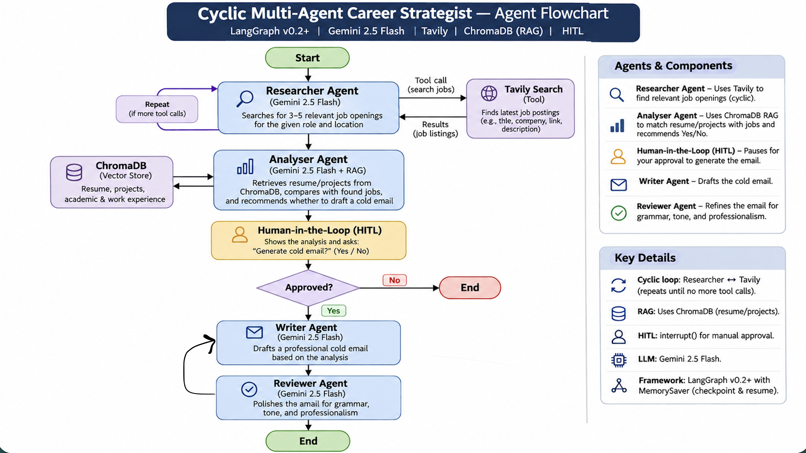

# The Career Architect

A **Cyclic Multi-Agent Career Strategist** that researches jobs, analyzes them against your resume, and drafts personalized cold emails—with human-in-the-loop approval at every step.

## Features

- **Job research** — Uses Tavily to find relevant openings for your role and location
- **RAG-based analysis** — Queries your resume and projects from ChromaDB to compare against found jobs
- **Human-in-the-loop (HITL)** — Pauses for your approval before generating any cold email
- **Cold email generation** — Drafts and polishes professional outreach emails tailored to each opportunity

## Workflow


## Tech Stack

- **LangGraph** (v0.2+) — Multi-agent orchestration and graph-based workflow
- **Gemini 2.5 Flash** — LLM for research, analysis, and email generation
- **ChromaDB** — Vector store for resume and project RAG
- **Tavily** — Job search API
- **FastAPI** — Backend API
- **Streamlit** — Frontend UI

## Setup

### 1. Clone and install dependencies

```bash
cd The-Career-Architect
pip install -r requirements.txt
```

### 2. Environment variables

Create a `.env` file in the project root:

```env
LLM_KEY=your_google_ai_api_key
TAVILY_KEY=your_tavily_api_key
BASE_URL=http://localhost:8000
```

- `LLM_KEY` or `GOOGLE_API_KEY` — Google AI API key for Gemini
- `TAVILY_KEY` — Tavily API key for job search
- `BASE_URL` — Backend URL (default: `http://localhost:8000`)

### 3. Run the application

**Terminal 1 — Backend**

```bash
uvicorn backend.app_controller:app --host 0.0.0.0 --port 8000
```

**Terminal 2 — Frontend**

```bash
streamlit run frontend/user_interface.py
```

Open [http://localhost:8501](http://localhost:8501) in your browser.

## Usage

1. **Upload your resume** (PDF)
2. **Select location** and **enter target role** (e.g., "AI Engineer")
3. Click **Analyze Jobs** — the system researches jobs and analyzes your fit
4. **Review the analysis** and choose **Yes** or **No** to generate a cold email
5. Copy the generated email and use it for outreach

## Project Structure

```
The-Career-Architect/
├── backend/
│   ├── agents.py       # LangGraph graph, nodes (researcher, analyser, writer, reviewer)
│   ├── app_controller.py  # FastAPI endpoints
│   └── utility.py      # ChromaDB ingestion and vector store
├── frontend/
│   └── user_interface.py  # Streamlit UI
├── requirements.txt
└── README.md
```

## API Endpoints

| Method | Endpoint | Description |
|--------|----------|-------------|
| POST | `/job-analysis` | Ingest resume, run research + analysis, pause at HITL |
| POST | `/resume` | Resume after HITL with `yes` or `no` decision |


## Development

This project was refined using **[Cursor](https://cursor.com)** for AI-assisted development. Cursor was used to:

- **Fix bugs** — Including ChromaDB `persist()` deprecation, LangGraph `messages_key` mismatch, and Streamlit function ordering
- **Speed up development** — Rapid prototyping, graph wiring, and API integration
- **Improve code quality** — Consistent error handling, type hints, and structure


## Evaluation & Reliability Engineering

### Problem

LLM-based job matching can incorrectly infer candidate qualifications from related technical experience or classify insufficient evidence as a missing skill.

Career Architect explores evidence-grounded skill classification to make job-fit analysis more transparent and verifiable.

### Evaluation Methodology

The experimental analyser uses ChromaDB to retrieve candidate information and Gemini to evaluate job requirements against retrieved evidence.

Each requirement is assigned one of three labels:

- **Demonstrated:** Explicit evidence supports the complete requirement.
- **Uncertain:** Evidence is partial, indirect, ambiguous, or insufficient.
- **Missing:** The candidate explicitly states they lack the required qualification.

The evaluation uses synthetic candidate profiles and manually assigned ground-truth labels.

### Experiment 1 — Single-Requirement Classification

Evaluated 15 synthetic candidate–requirement pairs, balanced across the three evidence categories.

**Result: 15/15 correct classifications (100%).**

This established initial functionality on short, controlled examples but does not demonstrate generalization to real-world resumes.

### Experiment 2 — Multi-Requirement Classification

Evaluated five synthetic candidate profiles against five job requirements each, producing 25 requirement-level classifications.

| Metric | Baseline prompt | Improved prompt |
|---|---:|---:|
| Correct classifications | 18/25 | 24/25 |
| Accuracy | 72% | 96% |
| Classification errors | 7 | 1 |

The baseline frequently classified insufficient evidence as **Missing**, instead of **Uncertain**.

### Targeted Improvement

A revised classification policy explicitly distinguishes missing qualifications from insufficient evidence.

The central decision rule is:

**Absence of evidence is not evidence of absence.**

The improved prompt reduced classification errors from seven to one on the same evaluation dataset.

### Remaining Failure

One scenario involving hands-on LLM benchmarking remained incorrectly classified as Missing rather than Uncertain.

This highlights the difficulty of interpreting negative statements that address only part of a broader technical requirement.

### Limitations

- Small, synthetic evaluation dataset.
- Ground-truth labels were manually assigned.
- The same multi-requirement cases informed the prompt revision and were used for the before/after comparison.
- Results do not establish performance on unseen real-world resumes.
- Structured-output validation and automated evidence verification remain future improvements.
- External LLM API availability and latency can affect evaluation execution.

### Future Improvements

- Evaluate on a larger, independently labeled dataset.
- Add structured output validation and evidence-span verification.
- Introduce LangSmith tracing and experiment tracking.
- Measure latency, cost, and reliability across repeated runs.
- Test longer resumes and requirements with conflicting or incomplete evidence.